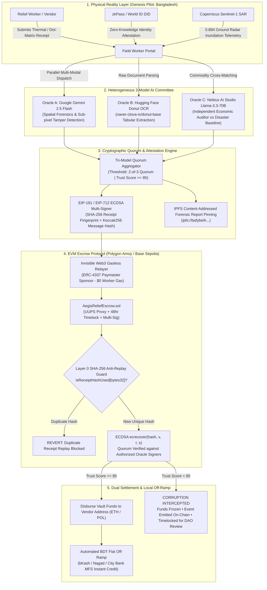

# AegisRelief Sovereign • System Architecture & Technical Specification

> **Zero-Trust Autonomous Disaster Relief Escrow Protocol Governed by a Heterogeneous 3-Model AI Committee & Invisible Web3 Relayer**

---

## 1. Executive Summary & Design Philosophy

The **Blockchain Oracle Problem** is notoriously lethal in disaster response: smart contracts cannot observe physical paper invoices, delivery manifests, or localized inflation surges without relying on centralized, corruptible human relays.

**AegisRelief Sovereign** solves this by establishing an autonomous, multi-layered attestation pipeline:
1. **Physical Reality Layer**: Paper receipt imagery captured via field terminals, corroborated with Sentinel-1 Satellite SAR ground inundation telemetry and zkPass Zero-Knowledge DIDs.
2. **Autonomous Multi-Model Forensic Layer**: A tri-model AI committee (Google Gemini 2.5 Flash, Hugging Face Donut OCR, and Nebius AI Studio Llama-3.3-70B) independently cross-examines the procurement document off-chain.
3. **Cryptographic Consensus Layer**: A 2-of-3 ECDSA multi-oracle quorum (`ecrecover` on-chain) enforces mathematical proof before triggering the escrow contract.
4. **Execution & Settlement Layer**: An ERC-4337 Paymaster sponsors all gas costs ($0.00 to frontline workers) while disbursing funds to vendors and triggering automated fiat off-ramps in local currency (BDT via bKash/Nagad).

---

## 2. High-Level Protocol Architecture



---

## 3. Cryptographic State Machine & Hashing Pipeline

### 3.1. Physical Receipt Fingerprint (`SHA-256`)
Every physical invoice undergoes deterministic cryptographic canonicalization:
$$\text{receiptHash} = \text{SHA-256}(\text{Raw Receipt Image Bytes} \parallel \text{Vendor Address} \parallel \text{Timestamp})$$

This fingerprint is permanently stored on-chain in the EVM storage slot:
```solidity
mapping(bytes32 => bool) public isReceiptHashUsed;
```
If an adversary attempts to resubmit the exact same paper receipt—whether 5 minutes or 5 years later—the smart contract immediately throws `ReceiptAlreadyDisbursed(receiptHash)` and reverts the transaction.

### 3.2. Off-Chain AI Attestation Message Hash (`Keccak-256`)
The multi-model engine packages its joint evaluation into a tightly packed EVM byte sequence:
```solidity
bytes32 messageHash = keccak256(
    abi.encodePacked(
        receiptHash,
        vendor,
        amountWei,
        trustScore,
        severityLevel,
        beneficiaryToken,
        auditMetadataURI
    )
);
bytes32 ethSignedMessageHash = keccak256(
    abi.encodePacked("\x19Ethereum Signed Message:\n32", messageHash)
);
```

### 3.3. Multi-Oracle Signature Recovery (`ECDSA ecrecover`)
The contract supports heterogeneous multi-oracle verification where each oracle card signs with its respective designated key:
```solidity
address signer = ecrecover(ethSignedMessageHash, v, r, s);
require(isAuthorizedOracle[signer], "Invalid Oracle Signature");
```

---

## 4. The Heterogeneous 3-Model AI Committee

| Model Node | Foundation Provider | Specialized Responsibility | Failure Mode Mitigated |
| :--- | :--- | :--- | :--- |
| **Oracle A** | **Google Gemini 2.5 Flash** | Sub-pixel visual forensic scanning, font stroke inconsistency detection, physical ink bleed analysis, optical tamper bounding. | Digital font superimposition, physical eraser alteration, pasted paper strips. |
| **Oracle B** | **Hugging Face Inference API** (`naver-clova-ix/donut-base`) | Deep learning document parser; extracts tabular data, commodity names, quantities, unit prices directly into strict JSON schemas. | OCR misreadings, decimal place shifts, blurred receipts, skewed camera angles. |
| **Oracle C** | **Nebius AI Studio** (`meta-llama/Llama-3.3-70B-Instruct`) | Independent economic auditor; cross-examines line items against emergency price baselines adjusted for disaster severity levels (15% to 40% surge limit). | Syndicate price gouging, cartel markups, unauthorized luxury items, quantity manipulation. |

---

## 5. Account Abstraction & Gasless Settlement (ERC-4337)

Frontline humanitarian relief workers operating in flood or earthquake zones cannot be expected to manage native gas tokens, handle gas spikes, or understand transaction fee mechanics.

AegisRelief implements an **Invisible Web3 Relayer Engine**:
- The field worker signs an off-chain relief voucher using their zkPass biometric DID.
- The relayer ingests the multi-oracle attestation and submits the transaction to the EVM contract.
- The **ERC-4337 Paymaster Sponsor Account** absorbs 100% of the gas cost.
- Gas cost to field worker: **$0.00**.

---

## 6. Automated BDT Fiat Off-Ramp Architecture

In Genesis Pilot zones like Sylhet and Cox's Bazar, local merchants need local fiat currency to replenish life-saving supplies immediately.
When `AegisReliefEscrow.sol` disburses crypto-collateral on-chain, the protocol triggers a Webhook listener that routes through licensed Mobile Financial Services (MFS):
- **bKash MFS API**
- **Nagad Digital Wallet API**
- **City Bank Dhaka Settlement Gateway**

The local merchant receives instant SMS confirmation in Bangladeshi Taka (BDT) calculated against real-time central bank exchange rates (e.g. ৳118.50 BDT / USD).
